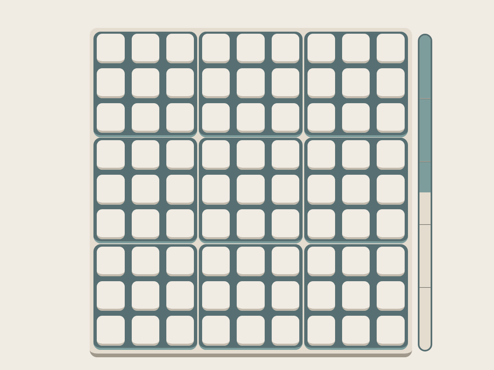
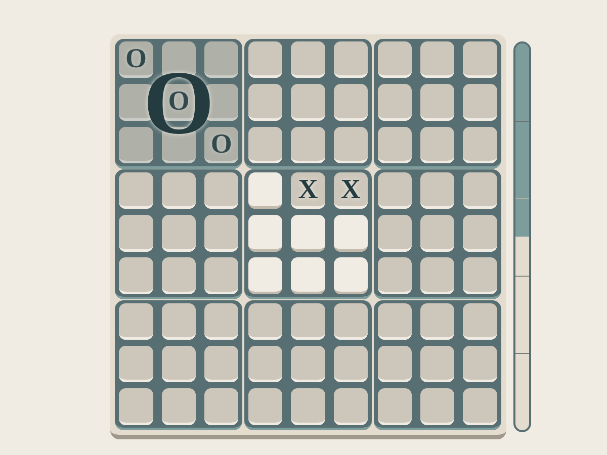

# HyperTris

A Ultimate Tic-Tac-Toe variant for experimenting with minimax algorithms and web deployment.

The game was taught to me from a friend of mine, which had altered slightly the rules of ultimate tic tac toe due to a 'alphabet game' effect, where he missunderstood the rules from his sister making out a complete new game. With the misunderstood some new interesing strategics dynamics emerged (or got enached at least) that resemblse what in chess is called "Deflection", and, with a relief of the JavaScript Web Worker, a smaller branching factor :P.

The game is accessible at:
- [https://roccotescaro.github.io/HyperTris/](https://roccotescaro.github.io/HyperTris/)

**The rules**:

The board is made of nine tic tac toe boards, what i will refers to as chunks.
Once a tic tac toe game in a chunk has reach its ending state (won by a player or drawn by getting filled with no tris), the chunk gets filled with the symbol of the player who won (nothing if drawn) on the big board. Either with a draw or with a win, once the chunk has reach its ending state, players can no longer play in it.

As in Ultimate tic tac toe, players cannot choose freely where to play. Once the first player has placed his/her symbol in one spot, the relative position of the cells determine in which chunks the opponent has to play. This is quite twisted but the idea is simple, lets say the first player has placed an **X** in the **middle-top cell of a chunk**, second player can place an **O** only in a free cell of the **middle-top chunk**.

This gives life to two scenarios: 
**What happens if the move of a player A obly the other one to move in a already decided chunk?**
Well, easy, B has to play in the same chunk in which the player A has just made his/her move (in the original version B could chose any still open chunk). 
**What happen if player A makes a tris or a draw in a chunk but his/her last move obly the enemy player B to play in a already completed chunk?** 
B can place his/her symbol wherever he/she wants in a still open chunk.

Thats all!!

**GOFAI**:

The site allows only to play against an Ai, which characteristics are briefly introduced below. Watch out 'couse its quite good...
The evaluation bar shows how the AI scores the current position. Its design was inspired (more like stolen :P) by the one on [lichess](https://lichess.org/). 
Developed bored me pretty rapidly, since i was interested only in the search algorithm implementation, the accessibilty and userfrinedliness has suffered from it a lot, but dont worry, if u dont get bored after the first lose u can just restart the game by refreshing the page.

This project was based on the CPW (Chess Programming Wiki) and Sebastian Lague videos, which links are left down below. 

- [CPW main page](https://chessprogramming.org/) 
- [Sebastian Lague v1](https://youtu.be/U4ogK0MIzqk?si=mXz3Jx_Xf-cseUeJ)
- [Sebastian Lague v2](https://youtu.be/_vqlIPDR2TU?si=UxrHjanPAIno6n9c)

> **Note**: as mentioned in the CPW main page the hosting has moved, the version this project was based on was the pages before the hosting changed, therefore I cannot ensure all the material is still up.

The main technique implemented are the following:

- Itterative Deepening Search
- Negamax (kind of minimax)
- Principal Variation Search (kind of adversarial search)
- Null Window Search
- Quiescence Search
- Alpha-Beta Pruning
- Trasposition Tables

In my tests, the AI can reach a search depth of up to 10 plies before putting too much pressure on the Web Worker. A ply is one player's move, not a full turn by both players. 

**Console commands**:

There aren't any console commands at the moment. I'll add them here if I expose any in a future version.